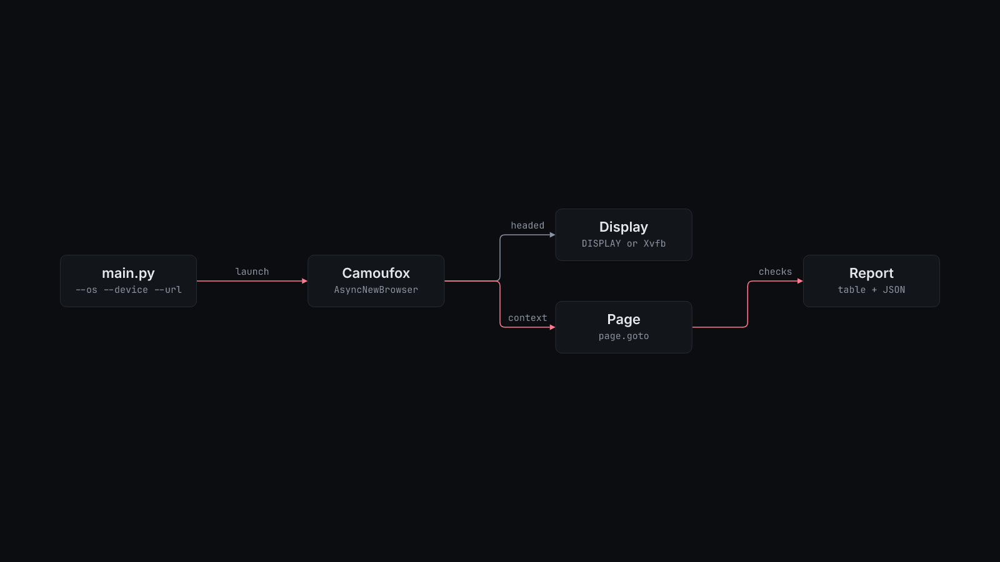

# How camoufox-agent works

`main.py` builds the launch options and calls `AsyncNewBrowser` from `camoufox.async_api` inside Playwright's `async_playwright()`. The options are `os` from `--os` and `humanize=True`. With `--proxy`, they also carry the parsed proxy and `geoip=True`. `pyproject.toml` installs the `camoufox[geoip]` extra for it.

`--headless-mode` picks the display:

- `native` runs headed on the current `DISPLAY`.
- `virtual` asks Camoufox to start its own Xvfb.
- `auto`, the default, runs on `DISPLAY` when it is set and on Xvfb otherwise.

`--device mobile` opens the context with a 390x844 viewport and an iPhone Safari user agent. `--device desktop` uses Camoufox's defaults.

The runner calls `page.goto(url, wait_until="networkidle")`, waits 1.5 seconds, then reads `navigator.userAgent`, `navigator.webdriver`, the elements with id `webdriver`, `chrome`, `plugins`, `languages` or `permissions`, and every two-cell table row. `--screenshot` writes `artifacts/<device>-<os>.png`. The report prints as a sorted table, values truncated at 64 characters, and then as JSON with full values. A launch or page error prints `runner failed: <error>` to stderr and exits with code 1.

The Docker entrypoint starts Xvfb on `:99`, sets `DISPLAY`, and runs `python3 main.py --headed` with your arguments.
